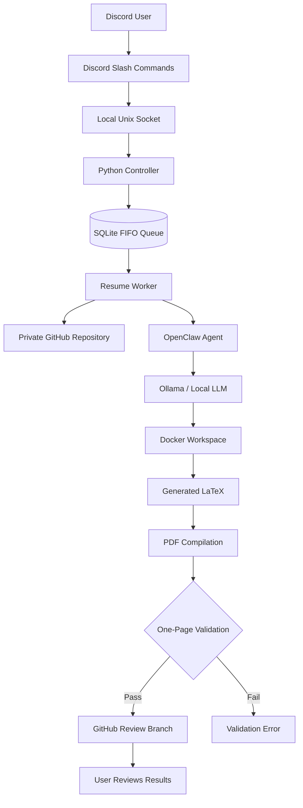

# CVPilot

**AI-assisted, job-specific resumes from Discord, with private GitHub workspaces, a persistent job queue, and LaTeX/PDF output.**

[](https://discord.gg/N2KNhvNm)
[](#tech-stack)
[](#how-it-works)

**[Join the CVPilot Discord Server](https://discord.gg/N2KNhvNm)** · [Example Resume (PDF)](examples/sample_resume.pdf) · [LaTeX Source](examples/sample_resume.tex)

CVPilot is a self-hosted, AI-powered resume assistant designed to simplify the job application process. It transforms job postings into tailored, one-page resumes while maintaining each user's career materials in a separate, private GitHub repository.

Users interact with CVPilot through Discord slash commands. Behind the scenes, a Python controller coordinates requests, OpenClaw and a locally hosted language model handle resume generation, and a Docker-based workflow produces validated LaTeX and PDF documents.

> **Project Status:** Actively developed and self-hosted. CVPilot is both a portfolio project and a running service. Some features require server permissions and operator configuration.

---

## Features

### AI-Powered Resume Tailoring

- Generate job-specific resumes from an HTTPS job posting URL.
- Tailor professional experience, projects, and technical skills to the target position.
- Use existing resumes and verified profile information as source material.
- Produce editable LaTeX source files and compiled PDFs.
- Validate that generated resumes fit on a single page.

### GitHub Integration

- Provision a dedicated private GitHub repository for each user.
- Maintain master resumes for different career paths.
- Store application-specific resumes with version control.
- Generate changes on separate review branches.
- Allow users to review and merge changes into their main branch manually.

### Discord Interface

- Interact with CVPilot through slash commands.
- Initialize and manage personal resume repositories.
- Submit job postings for resume tailoring.
- Track job progress and queue status.
- Manage master resumes and profile information.
- Restrict access through Discord roles and channels.

### Persistent Job Queue

- SQLite-backed queue for tracking requests.
- First-in, first-out (FIFO) scheduling.
- A single worker processes resume-generation jobs sequentially.
- Job state persists across controller restarts.
- Separate execution workspaces help prevent cross-user data access.

### Local AI and Sandboxed Execution

- Uses OpenClaw for AI-agent orchestration.
- Integrates with locally hosted models through Ollama.
- Uses Docker for isolated task execution.
- Keeps GitHub credentials and repository-management operations outside the agent workspace.
- Provides a controlled environment for generating and validating resumes.

---

## Getting Started

### 1. Join the Discord Server

**[Join CVPilot on Discord](https://discord.gg/N2KNhvNm)**

Join the server and obtain access to the CVPilot user role. Commands are available in the designated CVPilot channel.

Run:

```text
/cvpilot help
```

To see the available commands and their parameters.

### 2. Initialize Your Repository

Run:

```text
/cvpilot init
```

Provide your GitHub username when prompted.

CVPilot will create a private GitHub repository containing your career profile, master resume directories, and supporting files.

Accept the GitHub repository invitation to gain access.

### 3. Upload Your Master Resume

Add an existing PDF or LaTeX resume to the appropriate directory in your private GitHub repository.

Supported master resume categories include:

| Category | Intended Roles |
|----------|----------------|
| `swe` | Software Engineering |
| `ml` | Artificial Intelligence and Machine Learning |
| `systems` | Low-Level Software and Systems Programming |
| `it` | Information Technology |
| `web` | Web Development and UX |

Master resumes act as reference documents for future tailoring requests.

Currently, master resume uploads are handled through GitHub rather than direct Discord attachments.

### 4. Generate a Tailored Resume

Run:

```text
/cvpilot tailor
```

Provide the HTTPS URL of the job posting.

CVPilot will:

1. Retrieve the job description.
2. Identify relevant responsibilities, qualifications, and technologies.
3. Analyze your existing resume and career profile.
4. Tailor your experience and projects to the position.
5. Generate a LaTeX resume.
6. Compile and validate the PDF.
7. Push the results to a review branch in your private GitHub repository.

Your master resume is preserved unless you explicitly request and authorize changes.

### 5. Review Your Results

Check the status of your request:

```text
/cvpilot status
```

Once processing finishes, open your GitHub repository to review the generated files.

You can inspect the LaTeX source, download the compiled PDF, and merge changes when you're satisfied with the result.

---

## Discord Commands

CVPilot provides slash commands for managing repositories, resumes, and career profiles.

| Command | Description |
|---------|-------------|
| `/cvpilot help` | Display available commands and usage instructions |
| `/cvpilot init` | Initialize a private GitHub career repository |
| `/cvpilot repo` | Access your assigned repository |
| `/cvpilot tailor` | Generate a resume tailored to a job posting |
| `/cvpilot status` | View queue status and job progress |
| `/cvpilot master get` | View master resume information |
| `/cvpilot master upload` | Get guidance for updating a master resume |
| `/cvpilot profile show` | Display current career profile information |
| `/cvpilot profile sync` | Synchronize profile information from available sources |
| `/cvpilot settings master_edit` | Manage permission for master-resume edits |

Discord prompts users for required parameters when executing commands.

Additional administrative and diagnostic commands are restricted to the server owner.

---

## How It Works

CVPilot combines a Discord frontend, a Python backend, local AI inference, containerized execution, and GitHub-based version control.



### Architecture Overview

**1. Discord Command Listener**

The Discord interface receives slash commands, validates permissions, and forwards requests to the Python controller.

**2. Python Controller**

The controller handles repository provisioning, queue management, GitHub operations, and worker coordination.

Communication between the Discord listener and controller occurs through a local Unix domain socket.

**3. SQLite Job Queue**

Incoming resume requests are persisted in a SQLite database and processed sequentially using FIFO scheduling.

**4. OpenClaw and Ollama**

OpenClaw coordinates the resume-generation workflow. A locally hosted language model analyzes the job posting and available career information to generate tailored content.

**5. Docker Execution**

Resume-generation tasks run in containerized workspaces. This separates agent execution from important host-side resources and credentials.

**6. LaTeX Compilation and Validation**

Generated LaTeX is compiled into a PDF and checked to ensure the output meets the one-page requirement.

**7. GitHub Review Workflow**

Completed files are pushed to a separate branch in the user's private repository, where they can be reviewed before merging.

---

## Example Output

CVPilot produces both an editable LaTeX document and a compiled PDF.

A fictional example resume is included to demonstrate the intended output format.

- **[View Sample Resume (PDF)](examples/sample_resume.pdf)**
- **[View Sample Resume (LaTeX)](examples/sample_resume.tex)**

The example uses fictional personal information, projects, and experience. It does not contain any real user's private information.

The sample illustrates CVPilot's intended resume formatting rather than representing a specific end-to-end job-tailoring run.

---

## Tech Stack

| Component | Technology |
|-----------|------------|
| Programming Languages | Python, JavaScript |
| Discord Integration | discord.py |
| AI Orchestration | OpenClaw |
| Language Model | gpt-oss:20b |
| Local Inference | Ollama |
| Job Scheduling | Python, SQLite |
| Interprocess Communication | Unix Domain Sockets |
| Containerization | Docker |
| Resume Generation | LaTeX |
| PDF Compilation | latexmk |
| Version Control | Git |
| Repository Management | GitHub API |
| Hosting | Ubuntu Linux |
| Service Management | systemd |

CVPilot is designed to run locally on a self-hosted Linux machine without requiring a cloud-hosted language-model API for its primary inference workflow.

---

## Repository Structure

```text
CVPilot/
├── controller/
│   ├── dispatch.py
│   ├── github.py
│   ├── main.py
│   ├── store.py
│   └── worker.py
│
├── discord/
│   └── cvpilot_discord.py
│
├── plugin/
│   ├── index.js
│   ├── openclaw.plugin.json
│   └── package.json
│
├── repo-template/
│   ├── master-resumes/
│   │   ├── it/
│   │   ├── ml/
│   │   ├── swe/
│   │   ├── systems/
│   │   └── web/
│   ├── profile/
│   │   ├── MASTER_PROFILE.md
│   │   └── profile_sources.json
│   └── README.md
│
├── templates/
│   ├── AGENTS.md
│   └── skills/
│       ├── career-resume/
│       └── career-source-sync/
│
├── tests/
│   ├── test_controller.py
│   └── test_isolation.py
│
├── examples/
│   ├── sample_resume.tex
│   └── sample_resume.pdf
│
├── Dockerfile
├── .env.example
├── .gitignore
└── README.md
```

### Component Responsibilities

| Directory | Purpose |
|-----------|---------|
| `controller/` | Backend API, job scheduling, GitHub operations, and resume worker |
| `discord/` | Discord slash-command interface |
| `plugin/` | OpenClaw integration |
| `repo-template/` | Initial structure for user career repositories |
| `templates/` | AI agent instructions and resume-generation skills |
| `tests/` | Backend and isolation-focused tests |
| `examples/` | Synthetic example resumes |

---

## Development and Self-Hosting

CVPilot is currently a self-hosted application rather than a turnkey deployment package.

Running your own instance requires:

- Python 3
- Docker
- Git
- A Discord application and bot token
- A GitHub account or organization with repository-management permissions
- OpenClaw
- Ollama and a compatible local model
- LaTeX compilation tools
- A Linux environment for the hosted service configuration

### Run Tests

The project includes tests for controller behavior and user isolation.

```bash
python3 -m unittest discover -s tests -v
```

### Build the Docker Image

```bash
docker build -t openclaw-career-sandbox:1 .
```

### Configuration

The repository includes `.env.example` as a reference for configuring the application.

Real credentials should be stored outside the source repository.

For example:

```text
~/.config/cvpilot/controller.env
```

The hosted implementation uses separate systemd user services for the controller and Discord command listener.

A complete automated deployment installer is not currently included.

---

## Privacy and Security

CVPilot handles personal resumes and career information, so data separation and privacy are important design considerations.

### Private User Repositories

Each user receives a separate private GitHub repository for their resume and profile information.

Access is managed through GitHub repository permissions. The server operator and authorized administrators may also have access.

### User Data Isolation

The backend associates requests and repositories with verified Discord user identities.

Individual processing workspaces help keep user data separate during resume generation.

### Credentials

GitHub tokens, Discord credentials, SSH keys, and runtime configuration are not intended to be included in the public source repository.

### Human Review

Generated resumes are published to review branches rather than automatically replacing a user's main branch.

Users retain control over whether to accept generated changes.

### Security Limitations

CVPilot uses Docker and user-specific workspaces as isolation measures, but the project has not undergone an independent security audit.

These mechanisms should not be treated as a guarantee of isolation against malicious users.

The current service is intended for controlled use rather than unrestricted multi-tenant deployment.

**Important:** Users should only upload information they are comfortable storing in an operator-managed private GitHub repository and processing through the hosted service.

---

## Current Limitations

CVPilot is under active development. Current limitations include:

- Direct Discord attachment uploads for master resumes are not implemented.
- Generated review branches are not automatically merged.
- Pull request creation is not fully automated.
- The system depends on the quality and completeness of user-provided resume information.
- Resume generation may require manual review and correction.
- The project does not yet include a complete automated self-hosting installer.
- Additional security testing and stronger isolation would be needed for unrestricted public deployment.

---

## Future Improvements

Planned areas for development include:

- Direct resume uploads through Discord.
- Improved GitHub pull request integration.
- More sophisticated resume validation.
- Interactive confirmation of new skills and qualifications.
- Expanded support for additional job categories.
- Automated deployment and update workflows.
- Broader end-to-end testing.
- Improved monitoring and job diagnostics.

---

## Contributing

CVPilot is an actively developed personal project.

Feedback, bug reports, and suggestions are welcome.

If you encounter an issue or have an idea for improvement, feel free to open a GitHub issue or join the Discord community.

Source reuse is subject to the repository's license. If no license is present, public availability does not automatically grant permission to redistribute or modify the code.

---

## Join the Community

Interested in trying CVPilot or following its development?

**[Join the CVPilot Discord Server](https://discord.gg/N2KNhvNm)**

Use the bot to manage your career materials, generate tailored resumes, and streamline your job applications.

---

**Built with Python, OpenClaw, Ollama, Docker, LaTeX, and GitHub.**
