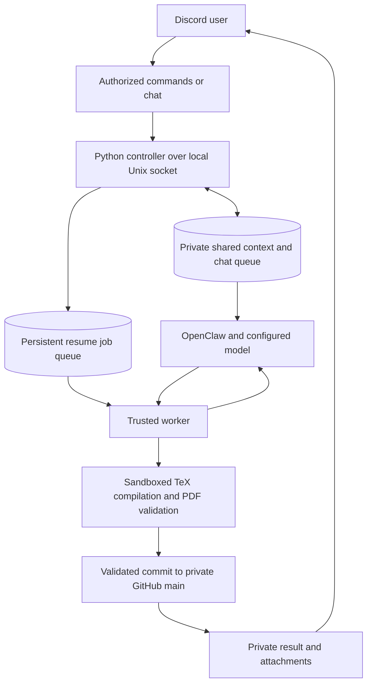

# CVPilot

**Job-specific resumes through Discord chat and commands, with private GitHub
workspaces, a detailed career profile, and editable TeX/PDF output.**

[](https://discord.gg/tMMPgSbg6V)

[Join the Discord server](https://discord.gg/tMMPgSbg6V) ·
[Example resume (LaTeX)](examples/sample_resume.tex)

CVPilot is a self-hosted resume assistant for any profession or field of study.
It uses your source resumes and confirmed experience to tailor a readable,
one-page resume to a job posting. Source resumes can have multiple pages.
Each user has a private GitHub repository, persistent job history, and a
conversation shared by chat and slash commands.

The service uses Python, OpenClaw, Ollama, Docker and GitHub. It is actively
developed and requires operator configuration; a complete installer is not
included.

## Get started

1. [Join the Discord server](https://discord.gg/N2KNhvNm) and obtain the
   server-issued CVPilot User role. Commands work in the designated channel and
   in DMs with the bot. Current membership and role permissions are checked for
   every request. Group DMs are unsupported.
2. Run `/cvpilot init github_username:<your-username>`, then accept the private
   repository invitation. `/cvpilot repo` returns its link.
3. Run `/cvpilot master upload file:<PDF-or-TeX> label:<your-label>`. Files can
   be up to 8 MiB each. Add `companion:<matching-file>` for a PDF/TeX pair.
   A TeX-only upload compiles to PDF automatically; a supplied pair is kept as
   provided. Use self-contained UTF-8 TeX supported by the compiler.
4. Once the upload finishes, run `/cvpilot profile sync` to build the detailed
   career evidence database. Tailoring can also use source resumes directly if
   the profile is empty or out of date.
5. Run `/cvpilot tailor url:<HTTPS-job-posting>`. If qualification questions
   appear, review them in DMs or `/cvpilot status`. Answer with
   `/cvpilot answer job_id:<id> question:<number> details:<your-experience>`;
   review and confirm the exact statement before it is saved. Then run
   `/cvpilot continue job_id:<id>`. Continuing without answers leaves those
   qualifications unconfirmed and excludes unsupported claims.
6. Completed PDF and TeX files arrive by DM and are committed to `main` in your
   private repository. `/cvpilot download job_id:<id>` retrieves attachments
   again. `/cvpilot status` shows one detailed job with history arrows, refresh,
   timing, checkpoints and an attached diagnostic report.

Labels are arbitrary lowercase names, starting with a letter and containing
letters, numbers or hyphens, up to 40 characters. They are not a fixed set of
technical roles. The default is `general`; examples include `teaching`, `sales`,
`healthcare`, `academic` and `creative`. Uploading under another label removes
the untouched `general` starter folder. Actual resumes and customized files in
`general` are preserved. Reusing a label replaces its current uploaded version;
older versions remain in Git history.

GitHub uploads to `master-resumes/<label>/resume.pdf` or `resume.tex` on `main`
are also supported. Direct GitHub edits do not automatically start compilation
or a profile-sync job.

## Chat and shared context

DM CVPilot, or mention it in the designated server channel, to use the same
operations conversationally. For example, attach a PDF and write:
"Upload this resume under the label teaching." Chat responses and files are
sent privately by DM. Slash commands provide precise typed arguments; chat
can ask for clarification. File operations still run through the controller.

Chat, commands and job outcomes share one private conversation per user.
The default history budget is 24,000 conservative token units, measured using
UTF-8 bytes and event overhead. Source material and system instructions have
separate prompt overhead. `/cvpilot context operation:show` displays usage.
At the limit, new model work pauses until the user chooses:

- `operation:compact`: summarize the active history. The summary can omit
  details and reduce accuracy; the full earlier transcript remains archived.
- `operation:wipe`: start a fresh active conversation. Earlier generations,
  the master profile, jobs, source resumes and Git history remain stored.

Idle conversation working sets leave CVPilot's RAM cache after five minutes
and reload from private SQLite on activity. This applies to application history;
it does not unload model weights or control provider KV caches or OS disk caches.

Profile statements from chat require explicit review and confirmation before
they become verified experience. After a confirmation preview in chat, type
its exact confirmation word. The model cannot confirm on the user's behalf.

## Tailoring and the master profile

CVPilot reviews the posting against source resumes and confirmed profile facts
before drafting. It can pause for focused qualification questions rather than
inventing experience. Supported terms from the posting can be included
naturally; keyword matching does not authorize new qualifications or hidden
keyword stuffing.

The first draft selects and adapts relevant evidence across sources. Subsequent
page-fit revisions measure rendered PDF overflow and target a concrete number
of line-equivalents. They prefer rewording wrapped bullets while retaining
their meaning, accomplishments, dates and metrics. Fonts, margins and spacing
are held fixed during refinement. Underfilled drafts can restore relevant
source-supported context; sparse sources are not padded.

Refinement has time, iteration and progress limits. Invalid or multi-page
resumes are not published. A substantially filled, validated one-page draft
may be kept with an explicit warning if a small amount of optional context
cannot be restored safely. Review the result for accuracy and readability.

`/cvpilot profile sync` builds a detailed evidence database, not shortened
resume notes. It extracts sources in bounded passes and retains factual records,
verbatim evidence, source paths, SHA-256 hashes and full extracted source text.
Historical records and user-confirmed facts survive later syncs; conflicting
or historical information needs review. The profile has no one-page limit.
Tailoring reads the profile and masters without changing them. AI master edits
require both the account setting and an explicit edit request.

## Discord commands

Bracketed parameters are optional. Run `/cvpilot help` for the in-bot list.

| Command | Purpose |
| --- | --- |
| `/cvpilot help` | Command usage |
| `/cvpilot init github_username:<name>` | Create a private repository and workspace |
| `/cvpilot repo` | Get your repository link |
| `/cvpilot master upload file:<PDF-or-TeX> [label] [companion]` | Upload sources; compile TeX-only uploads |
| `/cvpilot master get [label]` | Download the source PDF/TeX |
| `/cvpilot master edit instructions:<change> [label]` | Request a source edit when master editing is enabled |
| `/cvpilot master delete [label-or-commit]` | Preview and confirm deletion of one source folder |
| `/cvpilot tailor url:<HTTPS-posting>` | Queue a tailored resume |
| `/cvpilot answer job_id:<id> question:<number> details:<experience>` | Review and confirm a qualification answer |
| `/cvpilot continue job_id:<id>` | Resume a tailoring job awaiting qualification review |
| `/cvpilot status [job_id]` | View one job; arrows browse older/newer jobs |
| `/cvpilot download [job_id]` | Download completed resume attachments |
| `/cvpilot application delete [link-or-commit]` | Preview and confirm deletion of one tailored application |
| `/cvpilot profile show` | Open the detailed master profile |
| `/cvpilot profile sync` | Extract and merge evidence from all master sources |
| `/cvpilot profile edit instructions:<facts>` | Review and confirm a profile statement |
| `/cvpilot settings master_edit value:on\|off\|show` | Control permission for explicitly requested source edits |
| `/cvpilot history [limit]` | List recent commits on `main` |
| `/cvpilot revert commit:<ID>` | Confirm an inverse commit that undoes one change |
| `/cvpilot reset` | Confirm a reset to the initial template and delete other branches |
| `/cvpilot context [operation:show\|compact\|wipe]` | Inspect or manage conversation history |

For master deletion, supply exactly one of `label:<label>` or `commit:<ID>`.
For application deletion, supply exactly one of `link:<URL>` or `commit:<ID>`.
Application links can be a CVPilot GitHub result/folder/file URL or the original
posting URL if it identifies one current application.

Owner-only diagnostics in the configured server admin channel are
`/openclaw status`, `/openclaw model`, `/openclaw agents`, `/openclaw health`,
and `/openclaw contexts [user_id] [limit]`. The context command reports usage,
residency, limits and pending work. Changing a budget requires an explicit
target; supported budgets range from 2,048 to 64,000. These commands are not
available to ordinary users or in DMs.

## Jobs, files and Git history

Resume jobs use a persistent SQLite FIFO queue with one worker. Each keeps its
permanent job ID and also reports its current position, the number ahead, and
aggregate running/waiting load across users. Other users' job details stay
private. `needs-input` jobs release the queue. Chat has a separate durable turn
queue, and CVPilot serializes model calls across chat and resume work.

Status defaults to your newest job, or accepts an explicit job ID. Older/newer
arrows browse only your jobs; refresh updates the selected job. Status includes
timing, progress, errors, model explanations when available, and a full report.

```text
your-private-repository/
├── master-resumes/
│   └── <label>/
│       ├── resume.pdf
│       └── resume.tex
├── profile/
│   ├── MASTER_PROFILE.md
│   └── profile_sources.json
└── applications/
    └── YYYY/
        └── job-<id>-<company>-<position>/
            ├── resume.pdf
            ├── resume.tex
            ├── job-url.txt
            └── notes.md
```

A master can contain either format or a pair. Application names use posting
details when available, with bounded filename-safe slugs and the permanent job
ID. Older `job-<id>` folders remain supported.

Validated changes commit directly to `main`; no review branches or manual
merges are required. Commit messages identify the operation, source label or
application, and exact added, updated and deleted paths. Saved downloads refer
to their original commit, subject to current deletion and reset rules.
Unchanged jobs do not create extra commits. Publication journals recover
interrupted pushes without duplicating commits; concurrent changes to `main`
stop publication rather than being overwritten.

Deletion requires a preview and typing **DELETE** within two minutes. It
removes the selected folder from `main`, source inputs and CVPilot downloads.
Existing profile facts, Git history and previously sent Discord attachments
remain. `/cvpilot revert commit:<deletion-ID>` can restore the files.

Revert requires a preview and **REVERT**. It creates a new inverse commit,
preserving other nonconflicting changes and existing history. Reset requires
a preview and **RESET**. It restores the initial files and deletes every branch
except `main`, including user-created branches. Tags, account records and Git
history remain; earlier uploads/downloads become unavailable through CVPilot.
Neither deletion nor reset is secure erasure.

### Git identity and contribution credit

The current default identity is `CVPilot <cvpilot@cvpilot.invalid>`. It is an
unlinked automation label and does not provide GitHub contribution credit.
A Git author name does not create a GitHub account. Never guess an email under
`users.noreply.github.com`, because GitHub may link it to someone else's account.

Contribution credit for a dedicated bot requires an account the operator owns,
its exact GitHub-provided commit email, qualifying repository access and its
private-contribution visibility setting. User co-author credit would also need
explicit configuration; it is not currently added automatically. Repositories
can stay private. Historical author correction changes commit IDs and requires
a planned migration of saved references; changing future identity preserves
existing history.

## Architecture



The listener validates server membership and role permissions. The controller
owns operations and confirmation state. Model replies propose actions or
content; they cannot supply user identity, attachment bytes or confirmation
authority. The OpenClaw plugin coordinates routing so generic Discord handlers
do not produce a second disconnected conversation.

Task workspaces contain plain source files without Git metadata or keys.
The trusted worker manages Git and credentials outside the model's workspace.
PDF compilation runs in a networkless Docker container with shell escape
disabled and resource limits. Source TeX using `fontspec` or `unicode-math`
selects XeLaTeX automatically; other sources normally use pdfLaTeX. An explicit
supported TeX engine directive can select the compiler.

## Source layout and self-hosting

The public source layout is:

```text
CVPilot/
├── controller/              # Commands, queues, Git, generation and validation
│   └── conversation/        # Shared context, persistence and chat planning
├── discord/                 # Native discord.py commands and chat adapter
├── plugin/                  # OpenClaw routing and scoped tool guards
├── repo-template/           # Initial private repository files
├── templates/               # Agent instructions and resume/source-sync skills
├── tests/                   # Mocked services and temporary SQLite/Git tests
├── deployment/              # Reviewed service/configuration examples
├── examples/                # Fictional sample resume
├── Dockerfile
├── .env.example
├── sync_cvpilot_public.py
└── README.md
```

In the live installation, application code is under
`~/.local/share/cvpilot/app/`, the Discord adapter is under
`~/.local/share/cvpilot/discord/`, and the installed OpenClaw plugin is under
`~/.openclaw/extensions/cvpilot/`.

Self-hosting requires Python, discord.py, Git, Docker, a Discord bot, a GitHub
organization and repository-management credentials, OpenClaw, and a configured
model provider. The current default model is `ollama/gpt-oss:20b`. The Docker
image supplies TeX, latexmk, fonts and PDF inspection tools. The hosted service
uses Linux/systemd; no complete installer is included.

From the exported source root, or the live `app/` directory:

```bash
python3 -m compileall -q controller
python3 -m unittest discover -s tests -v
docker build -t openclaw-career-sandbox:1 .
```

Tests use temporary state and mocks. Do not point them at live databases or
real user repositories. [Deployment notes](deployment/README.md) and
[`.env.example`](.env.example) are reference material, not a ready-to-run
deployment. Keep credentials in private host configuration such as
`~/.config/cvpilot/controller.env`; the Gateway has its own environment.

The controller and Discord adapter use separate services. Preserve the
controller's required `PrivateTmp=no` compatibility override on affected hosts.
OpenClaw's optional Discord agent components must remain disabled when sharing
the bot with CVPilot's listener, so their generic form handlers do not compete
with confirmation controls. Internal `career-` agent IDs, workspace names,
skill names, `/career` container paths and the compiler image tag remain
intentional compatibility identifiers.

## Privacy and operational limits

Each user repository is private, with access controlled by GitHub permissions.
The operator and authorized administrators may have access to stored data.
Conversation archives, uploads, diagnostics, deploy keys and databases stay
in private runtime storage. `jobs.sqlite` stores resume work; `contexts.sqlite`
stores conversations and chat turns. A context wipe does not erase archives,
source files, profile evidence or Git history.

The public source sync script previews changes by default. `--apply` updates
existing allowlisted files; `--apply --confirm-add-delete` also permits source
additions and deletions. It does not commit or push. Public root documentation
and separately maintained deployment examples require their own review; the
current script does not synchronize this root README. Live credentials,
databases and user repositories are excluded. `deployment/jobs.sqlite.example`
is an empty schema example, not a backup of user jobs.

Model output can be inaccurate or fail validation, and some postings cannot be
retrieved. PDF extraction can lose formatting; PDF-only sources require a new
layout. Source TeX must be self-contained and use supported compiler packages.
The one-page requirement does not replace human review of the resume's quality.
Docker and application checks provide isolation measures; the project has not
undergone an independent security audit. The current service is intended for
controlled use rather than unrestricted multi-tenant deployment.

## Examples and contributing

The tracked [sample TeX source](examples/sample_resume.tex) uses fictional
information and can be compiled to preview a PDF. It illustrates the intended
format rather than a guaranteed end-to-end result for every job. Generated
PDFs are excluded from source synchronization.

Feedback and bug reports are welcome through the project or
[Discord community](https://discord.gg/N2KNhvNm). Source reuse is subject to an
applicable license; public availability alone does not grant reuse rights.
